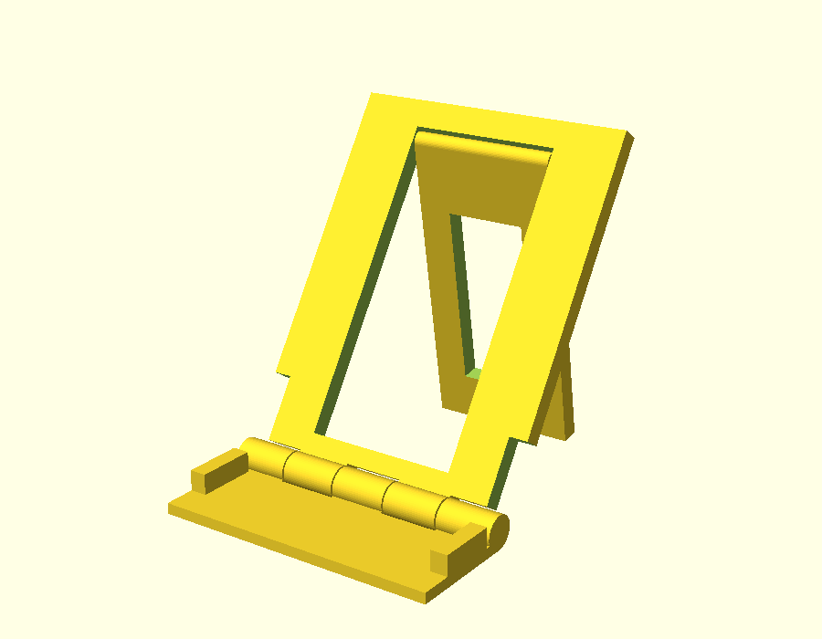
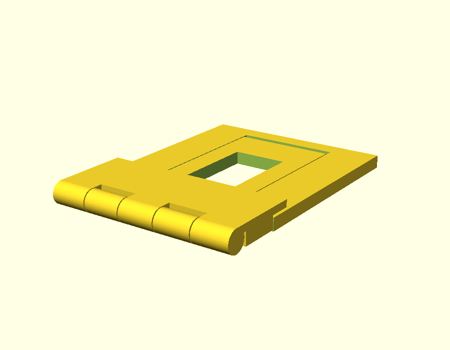

# Pixel 10 Pro Folding Stand

A print-in-place phone stand that folds flat, sized for the Google Pixel 10 Pro
(152.8 × 72.0 × 8.6 mm). Portrait orientation, about 57° viewing angle.

| Open | Folded |
|---|---|
|  |  |

## Files
- `models/pixel-10-pro-folding-stand.stl` – print this (one flat piece, 3 hinged bodies).
- `source/folding_stand.scad` – parametric OpenSCAD source.

## Printing
- Printed flat, **front face up**, exactly as exported. No supports, no brim needed.
- Footprint 84 × 145 mm, so it fits any common bed.
- PLA or PETG, 0.2 mm layers, 3+ perimeters, 20–30 % infill.
- Hinge clearance is 0.4 mm. Lower it for a finer nozzle, raise it if the hinges fuse. After printing, flex each hinge a few times to free it.
- Stick small rubber or TPU pads on the leg foot for grip on smooth desks.

## Use
- **Open:** unfold the ledge flat on the table, raise the back plate, then swing the leg out behind it until the foot touches the table.
- **Fold:** swing the leg back into the window, then fold the ledge up and over the back plate. The ledge posts drop into the pockets in the plate.

The phone stands in portrait between the two side posts. There is no front lip, so it works with
most cases; raise `side_slack` in the SCAD file for a thick one.

## Design notes
- The phone's bottom edge sits on the ledge, so the USB-C port is blocked while it is standing. Use wireless charging (Qi2), or add a cable cut-out.
- The leg is held by friction (it sits about 10° off vertical), so give the foot a grippy pad.
- Collision-checked in OpenSCAD across the open, folding and swing poses. **Not yet test-printed**, so expect to tweak clearances.

## Parameters worth changing
`alpha` (lean angle), `side_slack` (case clearance), `Y2` (plate and leg length), `c` / `g` (hinge clearances).
Re-export with: `openscad -o models/pixel-10-pro-folding-stand.stl -D 'part="flat"' source/folding_stand.scad`
